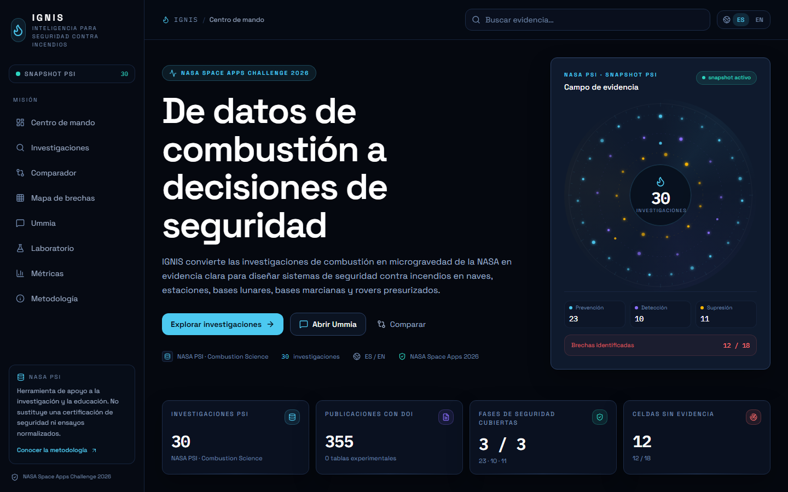
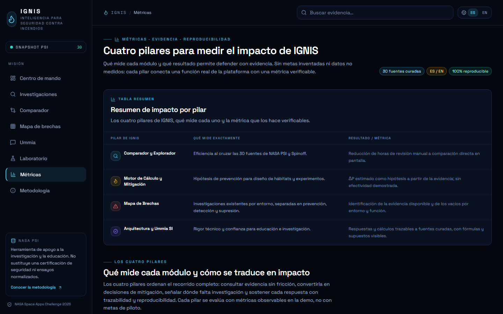
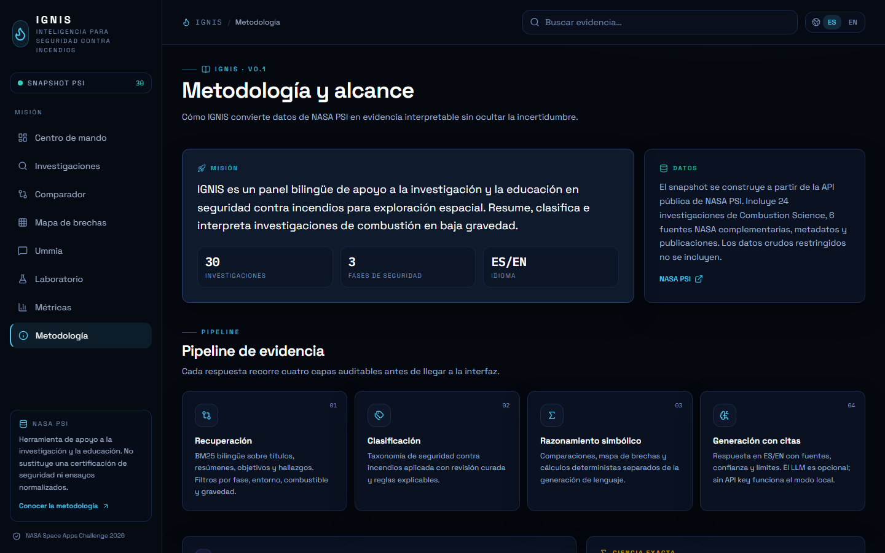
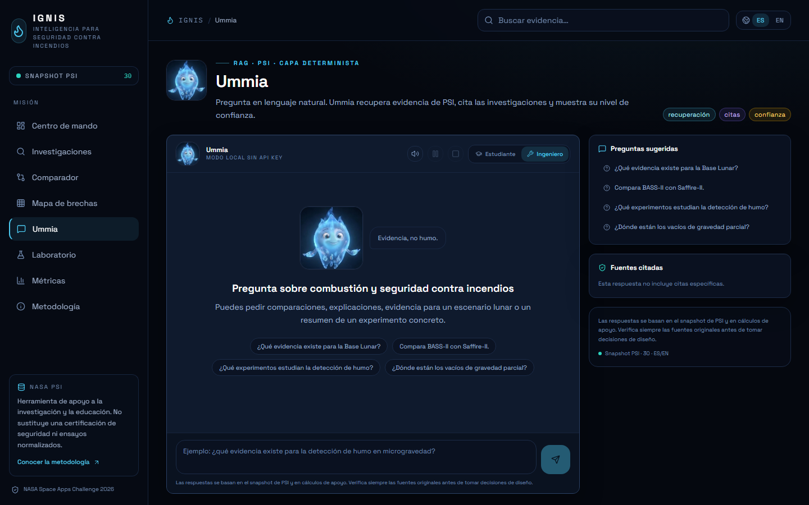
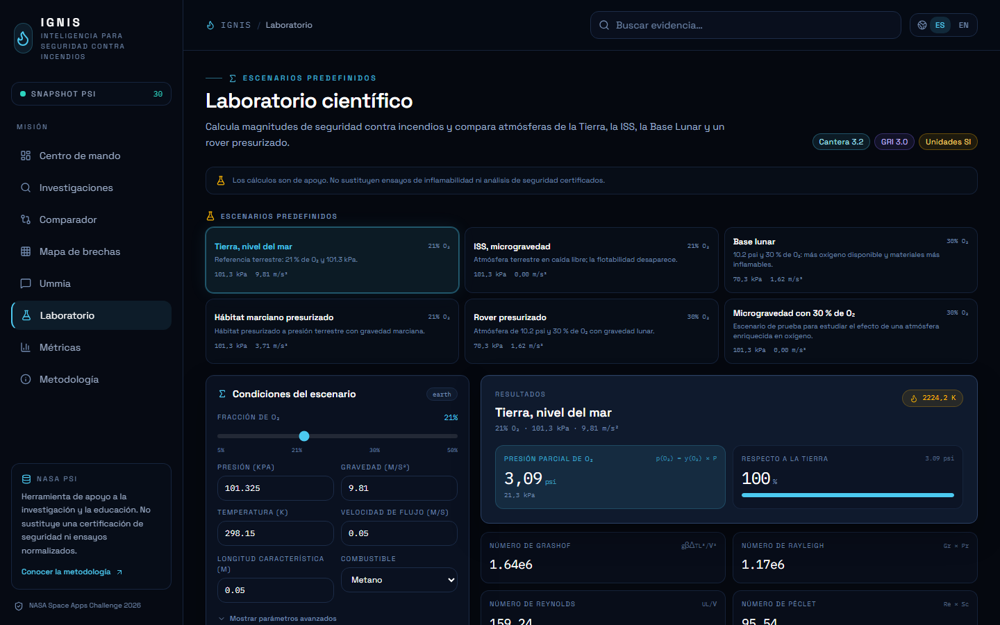
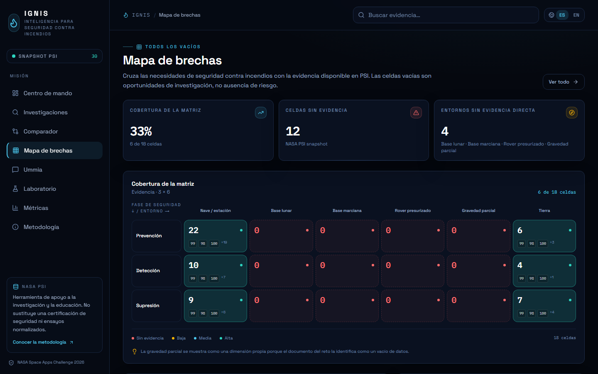
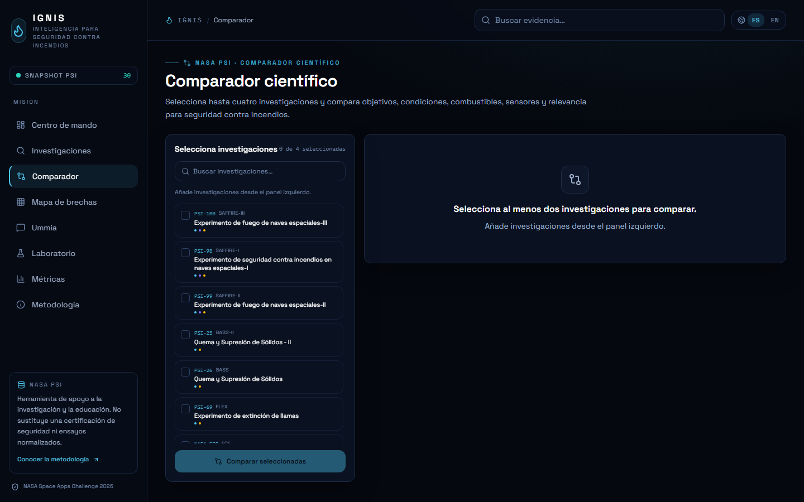
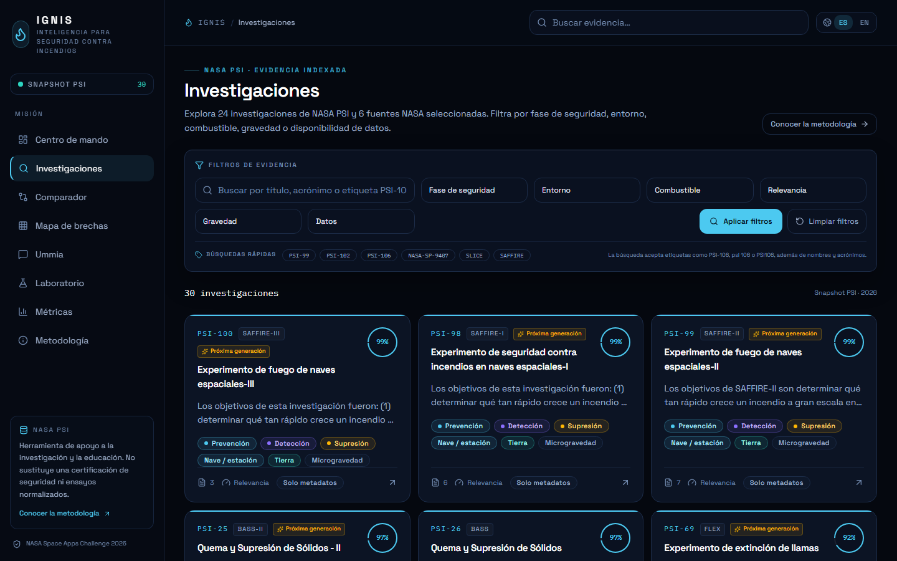

# IGNIS - Dashboard

[](https://www.python.org/)
[](https://fastapi.tiangolo.com/)
[](https://www.uvicorn.org/)
[](https://www.postgresql.org/)
[](https://github.com/pgvector/pgvector)
[](https://www.docker.com/)
[](https://nextjs.org/)
[](https://reactjs.org/)
[](https://www.typescriptlang.org/)
[](https://tailwindcss.com/)
[](https://cantera.org/)
[](https://numpy.org/)
[](https://scipy.org/)
[](https://pint.readthedocs.io/)
[](https://www.sympy.org/)
[](https://scikit-learn.org/)
[](https://git-scm.com/)


**De datos de combustión a decisiones de seguridad.**

Panel bilingüe (ES/EN) que resume, clasifica e interpreta la investigación de combustión en microgravedad de NASA PSI para apoyar la seguridad contra incendios en la exploración espacial. Construido para **NASA Space Apps Challenge 2026**.

> IGNIS is a bilingual fire-safety intelligence dashboard for NASA PSI combustion research. It combines curated scientific synthesis, deterministic calculations, and traceable retrieval so the platform is useful even without an AI API key.

---

## Equipo de desarrollo

| Nombre | Rol |
|---|---|
| Arrambide Escamilla, Vanessa Nohely | Documentadora |
| Bazaldua Contreras, Brayan Alberto | Desarrollador / Programador (Backend y Frontend) |
| Caballero Rivera, Jonathan David | Documentador |
| Morales Ortiz, Mariana Elizabeth | Documentadora |
| Vera Reyes, Diego Alejandro | Desarrollador / Programador (Backend y Frontend) |

---

## Demo en vivo

| Servicio | URL |
|---|---|
| **Frontend (Vercel)** | https://frontend-green-psi-80.vercel.app |
| **API (Railway)** | https://spaceapps-combustion-production.up.railway.app |
| **Docs API** | https://spaceapps-combustion-production.up.railway.app/docs |
| **Base de datos** | Neon PostgreSQL (pgvector) |

---

## Capturas de pantalla

| Dashboard | Métricas |
|---|---|
|  |  |

| Metodología | Ummia (Copiloto) |
|---|---|
|  |  |

| Laboratorio | Mapa de brechas |
|---|---|
|  |  |

| Comparador | Investigaciones |
|---|---|
|  |  |

---

## Funcionalidades

| Módulo | Qué resuelve |
|---|---|
| Centro de mando | Estado del snapshot, cobertura por fase, brechas y evidencia prioritaria. |
| Investigaciones | Búsqueda por nombre o etiqueta, filtros por fase/entorno/combustible/gravedad, orden y paginación. |
| Ficha científica | Objetivo, enfoque, impactos, hallazgos curados, limitaciones, hardware, sensores, publicaciones y DOI. |
| Comparador | Hasta cuatro investigaciones lado a lado con similitudes y diferencias explicadas. |
| Mapa de brechas | Matriz 3 fases × 6 entornos, con celdas sin evidencia directa visibles. |
| Copiloto (Ummia) | Preguntas en lenguaje natural con recuperación BM25, citas y confianza. Voz con pausa/reanudación. |
| Laboratorio | Escenarios predefinidos (Tierra, ISS, Base Lunar, Marte), cálculo con Cantera/GRI 3.0, índice de atención, plan de acción y protocolo operativo condicional. |
| Métricas | Cuatro pilares de impacto con métricas verificables, tabla resumen y beneficiarios. |
| Metodología | Pipeline auditable, arquitectura, equipo, alcance y límites. |

---

## Stack tecnológico

- **Frontend:** Next.js 16 (App Router), React 19, TypeScript, Tailwind CSS 4, next-intl, Recharts, lucide-react.
- **Backend:** Python 3.12, FastAPI, SQLAlchemy 2, Pydantic 2.
- **Datos:** PostgreSQL 16 con pgvector, snapshot local reproducible.
- **Ciencia:** Cantera 3.2, GRI 3.0, NumPy, SciPy, Pint, SymPy, scikit-learn.
- **IA:** Capa neuro-simbólica con recuperación léxica + taxonomía + cálculos; LLM opcional (mock, Gemini, OpenAI-compatible, Ollama).

---

## Inicio rápido

### Requisitos

- Node.js 22+
- Python 3.12+
- Docker Desktop

### Desarrollo

```bash
# 1. Clonar el repositorio
git clone https://github.com/VeraAlejandro/Ignis-Dashboard.git
cd Ignis-Dashboard

# 2. Preparar dependencias, base de datos y seed
./start.sh setup

# 3. Arrancar en modo desarrollo
./start.sh dev
```

La aplicación estará disponible en:
- Frontend: http://localhost:3000
- API: http://127.0.0.1:8000
- Docs API: http://127.0.0.1:8000/docs

### Docker (stack completo)

```bash
./start.sh docker
```

---

## Arquitectura

```
NASA PSI API
    ↓  fetch_psi.py
data/psi_snapshot.json → overrides curados →
data/nasa_sources.json → PostgreSQL 16 + pgvector
                                      ↓
                                FastAPI
                          ↙           ↘
                  Recuperación BM25   Motor científico
                  + citas + reglas    Cantera · NumPy
                          ↓              ↓
                    Next.js 16 ←────────┘
                    React 19 · Tailwind 4
                    next-intl (ES/EN)
```

---

## Ciencia y método

IGNIS separa deliberadamente tres capas:

1. **Evidencia recuperada.** Cada respuesta del copiloto se apoya en investigaciones del snapshot y devuelve accesiones citables.
2. **Razonamiento simbólico.** La clasificación combina una revisión curada de las 24 investigaciones PSI y las 6 fuentes NASA con reglas explicables.
3. **Cálculo determinista.** Las magnitudes físicas se calculan con fórmulas y librerías, no con el modelo de lenguaje:
   - Presión parcial de O₂: `p(O₂) = y(O₂) · P`
   - Número de Grashof: `Gr = g · ΔT · L³ / ν²`
   - Rayleigh: `Ra = Gr · Pr`
   - Reynolds: `Re = U · L / ν`; Péclet: `Pe = Re · Sc`
   - Damköhler: `Da = τ_flujo / τ_química`
   - Temperatura adiabática de llama: equilibrio HP con Cantera/GRI 3.0

Los supuestos se muestran en la interfaz. Los resultados son apoyo al análisis, no una certificación de seguridad.

---

## Datos

- **30 fichas de evidencia**: 24 investigaciones de *Combustion Science* de NASA PSI y 6 fuentes NASA (Spinoff y programas Glenn/Science).
- **355 publicaciones y referencias** con DOI o enlace institucional cuando está disponible.
- **12 de 18 celdas** de la matriz fase × entorno no tienen evidencia directa.
- Los hallazgos y limitaciones son **síntesis curadas** a partir de objetivos, enfoques e impactos públicos. No se inventan valores experimentales.

---

## Despliegue

Ver [ORACLE_DEPLOY.md](ORACLE_DEPLOY.md) para despliegue en Oracle Cloud Always Free (ARM64) y [NEON_DEPLOY.md](NEON_DEPLOY.md) para usar Neon como base de datos.

---

## Licencia

Proyecto desarrollado para el NASA Space Apps Challenge 2026. Código disponible bajo licencia MIT.

---

## Agradecimientos

Datos: NASA Physical Sciences Informatics (PSI), NASA Spinoff y NASA Glenn Research Center. IGNIS es un proyecto independiente del NASA Space Apps Challenge y no está afiliado oficialmente a la NASA.
